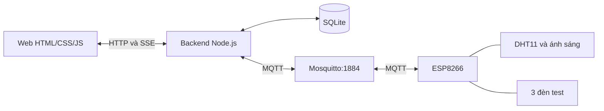

# ESP8266 và 3 đèn test

Backend Node.js nhận MQTT, lưu SQLite và cấp dữ liệu thật cho Dashboard, Data Sensor và Action History. Sketch Arduino cũ được giữ nguyên; bản mở rộng nằm trong `hardware/iot_control`.



## Chân và thiết bị

| Nút trên web                | Topic                 | Chân NodeMCU | GPIO |
| --------------------------- | --------------------- | ------------ | ---- |
| Đèn                         | `esp8266/led1`        | D1           | 5    |
| Quạt, mô phỏng bằng đèn     | `esp8266/led2`        | D5           | 14   |
| Điều hòa, mô phỏng bằng đèn | `esp8266/led3`        | D6           | 12   |
| DHT11                       | `esp8266/sensor_data` | D4           | 2    |
| Ánh sáng                    | `esp8266/sensor_data` | A0           | ADC  |

Giữ D1/D5 cũ, thêm D6. LED rời cần điện trở hạn dòng; bóng DC cần mạch đệm/driver và nguồn phù hợp, không cấp nguồn bóng trực tiếp từ GPIO. Firmware dùng `ACTIVE_HIGH=true` và khởi động với các đèn tắt.

## Cấu hình và nạp firmware

```powershell
cd D:\Dev\IoT\fe
npm.cmd install
npm.cmd run setup:hardware
```

Lệnh setup đọc WiFi/MQTT từ sketch cũ `../sketch_sep16a/sketch_sep16a.ino`, tạo `.env` và `hardware/iot_control/secrets.h` nếu chưa có. Không ghi đè cấu hình riêng đã có và không in mật khẩu. Hai file này đã được tạo trên máy hiện tại và được Git bỏ qua.

Nếu không có sketch cũ, sao chép `.env.example` thành `.env`, `secrets.example.h` thành `secrets.h`, rồi điền thông tin.

- `.env`: backend dùng `mqtt://127.0.0.1:1884` và tài khoản Mosquitto.
- `secrets.h`: `MQTT_HOST` phải là IPv4 máy tính trên mạng WiFi của ESP8266. Không dùng localhost ở ESP8266; nếu IP thay đổi, sửa rồi nạp lại.
- Mở `hardware/iot_control/iot_control.ino` trong Arduino IDE; giữ `secrets.h` cùng thư mục, chọn đúng board/cổng USB, rồi Verify/Upload.
- Firmware đã biên dịch thành công với NodeMCU 1.0, ESP8266 core 3.1.2, PubSubClient 2.8 và DHT 1.4.7. Chưa nạp lên board vật lý.
- Serial Monitor: 115200. Firmware gửi cảm biến mỗi 2 giây, trạng thái GPIO mỗi 10 giây, kết nối lại khi mất mạng và báo availability online/offline.

## Chạy web và backend

```powershell
npm.cmd run account:create
npm.cmd start
```

Lệnh `account:create` cấp tài khoản bằng tên đăng nhập, tên hiển thị và mật khẩu (8–128 ký tự, nhập ẩn). Chỉ cần tạo một lần cho mỗi người; không có đăng ký công khai. Mở [http://localhost:3000/](http://localhost:3000/) rồi đăng nhập. Trên Windows, lệnh start dùng broker đã chạy hoặc mở Mosquitto bằng `C:/Program Files/mosquitto/mosquitto.conf` khi cổng 1884 chưa hoạt động. Ctrl+C dừng backend và chỉ dừng broker do chính lệnh này mở. Nếu đang chạy backend cũ, Ctrl+C rồi start lại để nhận chức năng đăng nhập.

Nếu tự quản lý broker, chạy hai lệnh trong hai terminal:

```powershell
& "C:\Program Files\mosquitto\mosquitto.exe" -c "C:\Program Files\mosquitto\mosquitto.conf"
npm.cmd run start:backend
```

Có thể giữ Live Server ở cổng 5500, chọn **Dùng phần cứng** ở đầu trang; backend 3000 vẫn phải chạy. Nút **Dữ liệu mẫu** mở riêng chế độ demo.

| Hiển thị              | Cách kiểm tra                                                                                                         |
| --------------------- | --------------------------------------------------------------------------------------------------------------------- |
| ESP8266 trực tuyến    | Nhận phản hồi mới từ firmware 3 đèn; nút điều khiển được mở.                                                          |
| Cần cập nhật firmware | Board còn chạy code 2 LED cũ; nạp sketch mới.                                                                         |
| MQTT chưa kết nối     | Kiểm tra broker, tài khoản trong `.env`, `data/mosquitto.log`.                                                        |
| ESP8266 ngoại tuyến   | Kiểm tra nguồn, WiFi và IPv4 máy tính trong `secrets.h`; nếu không vào được broker, kiểm tra mạng/firewall cổng 1884. |
| Backend chưa kết nối  | Chạy `npm.cmd start`, kiểm tra cổng 3000.                                                                             |

Mất kết nối sẽ khóa nút; chế độ thật không tự chuyển sang dữ liệu giả.

Nếu web báo ngoại tuyến nhưng backend đã nối MQTT, mở Serial Monitor 115200 rồi nhấn RST trên ESP. Firmware in riêng `[WiFi]` và `[MQTT]`: nếu chưa có `[WiFi] Connected`, kiểm tra SSID/mật khẩu; nếu đã có IP nhưng MQTT lỗi, kiểm tra `MQTT_HOST`, cổng 1884, tài khoản và firewall. Máy tính đổi mạng có thể làm cả WiFi lẫn IP trong firmware cũ không còn phù hợp. Sửa `secrets.h` cần Upload lại để board nhận cấu hình mới.

## Dữ liệu và xác nhận

- Ánh sáng thật là ADC 0–1023, chưa có hiệu chuẩn sang lux.
- Backend gửi `ON|commandId` hoặc `OFF|commandId`. Firmware trả `commandId`, `protocol:2`, `result`, `action`, `led1/led2/led3` trên `esp8266/status`.
- Lệnh chỉ Success khi mã lệnh, hành động và GPIO khớp. Timeout mặc định 8 giây hoặc mất kết nối là Failed. Thời gian hiển thị xử lý tối thiểu 500ms không tự tạo thành công.
- Xác nhận GPIO phản ánh mức logic, chưa phải phép đo dòng điện hay xác nhận bóng thực sự sáng.
- ON/OFF thuần vẫn dùng được từ Mosquitto. Lệnh gửi ngoài web đồng bộ trạng thái nhưng không được tự ghi thành lệnh của người dùng web.
- Topic cũ được giữ; thêm `esp8266/led3` và `esp8266/availability`.
- SQLite tại `data/iot.sqlite`: cảm biến và lịch sử được lưu qua các lần chạy; lệnh còn pending khi backend dừng được chuyển Failed.
- Dashboard dùng 60 mốc gần nhất và thang đo thích ứng. Hai bảng tìm kiếm/lọc/phân trang tại backend, giữ lựa chọn 5/10/20/50 dòng.
- Thời gian lưu ISO và hiển thị ngày/tháng/năm, giờ theo Asia/Bangkok. Người gửi lấy từ tên tài khoản đang đăng nhập; backend bỏ qua tên do trình duyệt tự gửi.
- Tài khoản/phiên lưu ở `data/auth.sqlite`, mật khẩu được băm bằng scrypt. Phiên 8 giờ; Đăng xuất thu hồi cookie và đóng luồng SSE. API xem/điều khiển yêu cầu đăng nhập. Cấp thêm người dùng bằng `npm.cmd run account:create`.

## Kiểm tra và Figma

```powershell
npm.cmd test
npm.cmd run export:figma
```

Bộ kiểm tra gồm API/SQLite, đăng nhập/đăng xuất/hết phiên, DOM, lỗi/timeout/ACK và ba thiết bị qua broker MQTT test riêng. Chưa bật/tắt đèn vật lý. Các bản Figma nhúng dữ liệu mẫu, không chứa tài khoản hoặc mã kết nối backend; bản trang đăng nhập chỉ dùng để import thiết kế.

## Tài liệu

- [MQTT.js](https://github.com/mqttjs/MQTT.js)
- [Mosquitto](https://mosquitto.org/man/mosquitto-conf-5.html)
- [ESP8266 Arduino core: GPIO/ADC](https://arduino-esp8266.readthedocs.io/en/latest/reference.html)
- [DHT sensor library](https://github.com/adafruit/DHT-sensor-library)
- [Node.js SQLite](https://nodejs.org/api/sqlite.html)
